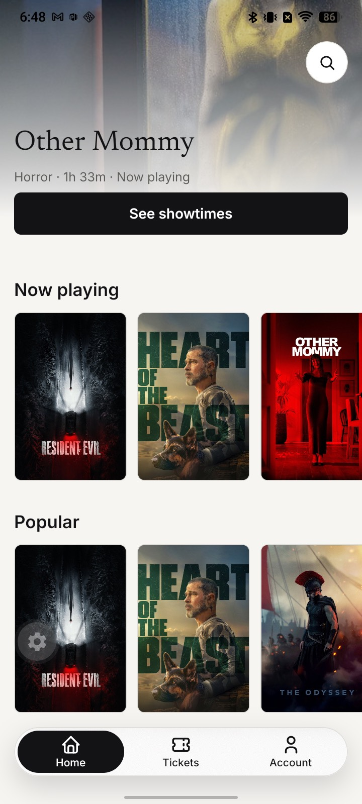

# Matinee mobile

Matinee is a cinema ticket booking app: browse movies, pick seats on a seat map, pay, get a QR ticket. Built with React Native and Expo.



<!-- TODO (Dave): swap in a GIF of the full booking flow when recorded. -->

- **Android build (download):** https://expo.dev/accounts/hennit_dave/projects/matinee/builds/ef7c7345-80bd-43cf-a9bf-1d5f534817e7
- **Demo video:** [demo video](https://lnkd.in/p/dM-k2isA)
- **Server repo:** https://github.com/Hennit-Dave/matinee-server
- **Payments run in Stripe test mode** — no real charges.

## Status

Slice 0: an Expo Router skeleton with a 3-tab layout (Home, Tickets, Account) themed from
`src/tokens/tokens.ts`, and a dev-only `/health` check screen proving the app can reach the server. No
real screens or features yet. This README is written as the build goes.

## Tech stack

React Native + Expo · TypeScript · TanStack Query · Zustand · Reanimated · expo-secure-store · Sentry

(Zustand and Sentry are decided but not installed yet — ADR 0006 defers each native module to the slice that
first needs it. Reanimated, expo-haptics and, with the seat-hold slice, expo-secure-store and expo-crypto are
installed; all four ship in Expo Go, so none of them needs an EAS build.)

## How to run locally

```
npm install
cp .env.example .env
npm start
```

Set `EXPO_PUBLIC_API_URL` in `.env` to point at your running `matinee-server`.
How depends on the target:

- **Android emulator (recommended):** forward the server port over adb, then
  use `localhost`:
  ```
  adb reverse tcp:3000 tcp:3000
  ```
  `.env`: `EXPO_PUBLIC_API_URL=http://localhost:3000`. Re-run that `adb reverse`
  after every emulator cold start — Expo restores the Metro port (8081) itself,
  but not this one.
- **Fallback:** `http://10.0.2.2:3000` (the emulator's host-loopback alias)
  works on some machines without adb reverse, but not reliably on all.
- **Physical device:** must be `https`. `src/api/config.ts` allows plain http
  only to `localhost`, `127.0.0.1` and `10.0.2.2`, so a LAN IP such as
  `http://192.168.x.x:3000` is rejected by design.

The dev-only health screen at `/dev-health` confirms the app can reach the
server (it calls `GET /health`). It is not in the tab bar; while Expo is
running, open it with a deep link:
```
npx uri-scheme open "exp://<metro-host>:8081/--/dev-health" --android
```
Use the `exp://…` host Expo prints on start.

`npm run typecheck`, `npm run lint` and `npm test` (unit tests only — see
`.github/workflows/ci.yml`).

## Public environment variables

Every `EXPO_PUBLIC_*` variable is bundled into the app and readable by anyone.

| Variable | Why it is safe to expose |
|---|---|
| `EXPO_PUBLIC_API_URL` | The public address of the Matinee server. Not a secret. |
| `EXPO_PUBLIC_STRIPE_PUBLISHABLE_KEY` | A Stripe **publishable** key (test mode). It identifies the Stripe account and cannot charge anyone; the secret key stays on the server. |
| `EXPO_PUBLIC_SENTRY_DSN` | A Sentry DSN (ingestion endpoint + project id). It can only **send** events to this project, not read them; it holds no secret. |

## Seat holds, the install id and live seats

The seat screen takes a real, server-side hold on the picked seats and keeps the room live (server: ADR 0015).

- **Continue** takes ONE atomic hold on the picked seats (all or none). While they are held, a countdown runs in the
  header (10 minutes, counted from the time the server says is left), the seats are drawn as yours and the map is locked.
  "Change seats" gives them back, and so does leaving the screen. When the time runs out a sheet says so.
- **The map refreshes itself** about every 5 seconds while the screen is on top and the app is in the foreground, so a seat
  someone else takes shows up before you press Continue. It pauses when the screen is covered or the app is in the
  background, and refreshes at once on return.
- **Fail closed:** if the server's Redis is down, new holds are refused with a retryable message and the seat map itself
  returns an error rather than a guess. Nothing is ever shown as free that might not be.
- **Payment opens checkout** (see "Payments" below): with seats held, Continue opens the native PaymentSheet over the seat
  screen (the hold stays alive). The app never calls the server's direct booking route; a booking is confirmed only by the
  server's verified webhook.

**The install id.** The app makes one random UUID per install (`expo-crypto`), keeps it in `expo-secure-store`
(Android Keystore, iOS Keychain), and sends it as `X-Client-Id`. The server treats it as the owner of a hold, so only this
install can release or re-acquire its own seats. It is a stand-in for a user id until sign-in exists, **not
authentication**: whoever learns the value can act as that install. It is generated on the device and is not an
`EXPO_PUBLIC_*` variable, so nothing is added to the table above. Clearing the app's data or reinstalling makes a new id.

**Running it locally** needs the 5a server (`matinee-server`, PR #23) with Redis; start both as that README says. `app.json`
carries the `expo-secure-store` config plugin (`faceIDPermission: false`; no biometrics are used). It only affects a native
build.

Evidence and the measurements behind these claims: `docs/evidence/traffic-5b/`.

## Too many requests (429)

The server limits holds, search and the seat map per install and per address (server: ADR 0016). A limited request gets
a `429 rate_limited` with a `Retry-After` in seconds, and the app waits that long instead of failing.

- **Holds.** Continue is refused: a Toast says "Slow down a moment, then try again." with **Try again**. Nothing was held (the
  limiter answers before the hold is attempted), so leaving the screen sends no release; that is the difference from a 503,
  where a hold may exist. Try again waits out `Retry-After` before it sends, like it does after a 503; the button shows
  it is working meanwhile.
- **Search.** A Toast says "Slow down a moment. Searching again shortly…", the skeleton stays, and the app asks again by
  itself after `Retry-After` (never sooner than a second). After three automatic retries it stops and shows
  "Too many searches" with a manual **Try again**, so a busy shared address cannot make the phone ask forever.
  Search now sends `X-Client-Id`, so the per-install search limit applies as well as the per-address one.
- **The seat map polling is untouched.** A stray 429 there is covered by the existing rule: one or two failed refreshes
  keep the map and show one Toast, the third in a row is the error screen.
- `Retry-After` is read as whole seconds and capped at 60. A 429 whose body is not the server's error shape is retryable
  but is not treated as "nothing held": a hold stays cautious, because it cannot be told apart from something in front of the
  server.

Evidence: `docs/evidence/traffic-5c/`.

## The waiting room, the busy screen and the seat cap

When a showing is busy the server lets a few people choose seats at a time and queues the rest (server: ADR 0017); it also caps how many seats one
install can hold (ADR 0018). The seat screen is built around that.

- **The line comes first.** Opening a showing joins its queue. With room, the person is let straight in and sees nothing of it. Otherwise the screen shows how
  many people are ahead of them, and the seat map loads only once they are let in. **Position only, never a time**: the line's speed is not known well enough
  to promise one. The app asks about its place at the pace the server sets (3 s at the front, up to 15 s at the back), a little randomised so a crowd does not
  ask in step; it asks for nothing while the app is in the background and asks at once on return. **Leave the queue**, back and swipe all give the place back.
- **Being let in** earns a success pulse and a short "Your turn" Toast. The note on the waiting screen says "Keep Matinee open": push notifications are a later
  enhancement, so the app does not promise what it cannot send (Figma's frame does; this is a deliberate difference).
- **Nothing breaks if the pass is lost.** The seat-map polls are the pass's heartbeat. If it lapses (a long spell in the background, a stretch when the server was
  too busy to answer), the next refused request makes the screen join again by itself, and Continue is retried once it is back. A line that is no longer empty
  sends the person to the waiting screen.
- **Two failed polls are kept quiet.** The last place stays on screen, marked "Trying to update...", and the third failure is shown. Every call has a 10 s timeout,
  because React Native's `fetch` has none and a poll that hangs would never count as a failure.
- **"We're very busy right now"** (Figma `107:15558`) replaces the waiting screen or the seat map when the server is overloaded, counts down to the server's `Retry-After`
  and tries again by itself; **Try again now** does not wait. It is for the booking funnel only. Home, Search and a film's detail keep the plain error state.
- **The seat cap.** A refused hold says "You can hold up to 8 seats for one showing.", with the number taken from the server's answer.

The server's default of 2 people inside at once is a demo setting: `WAITING_ROOM_MAX_ACTIVE` must be raised for production (server ADR 0017).
Evidence: `docs/evidence/traffic-5d/`.

## Payments (test mode)

Checkout uses the **native Stripe PaymentSheet** (server: ADR 0019), then polls the server until the booking is confirmed.

- **Checkout** is a modal over the seat screen (the hold stays alive). The server prices the order and returns a
  PaymentIntent `client_secret`; the app presents the PaymentSheet with it. The `Idempotency-Key` header is deterministic
  on the seats, so a cancelled sheet that is retried returns the SAME PaymentIntent — never a second charge.
- **PaymentSheet success is not a booking.** The server confirms only on its verified Stripe webhook, so the app polls
  `GET /orders/:reference` until the order resolves: `succeeded` → the ticket; `refunded` (the hold lapsed) → "your seats were
  released, payment refunded"; `failed` → "payment didn't go through"; and a sensible timeout → "still confirming" with a re-check.
- **The ticket** shows the movie, cinema, showtime, seats, the reference, the server-formatted total, and a **QR code**
  that encodes the reference (non-sensitive). Dark mode, accessibility labels and ≥48×48 touch targets throughout.
- **This needs an EAS dev build** — `@stripe/stripe-react-native` is a native module and does not run in Expo Go:
  ```
  eas login
  eas build --profile development --platform android
  ```
  Then run the dev client (`npx expo start --dev-client`) with `EXPO_PUBLIC_STRIPE_PUBLISHABLE_KEY` (test `pk_test_…`) set.

Evidence: `docs/evidence/payments-p2/`.

## In-app purchase rules (Apple App Store & Google Play)

Matinee sells **cinema tickets**: a real-world service redeemed at the door, not digital content consumed inside the app. That distinction decides whether Apple's and Google's in-app-purchase systems apply.

**Apple (App Store Review Guidelines).** IAP is required only for digital goods and services used within the app (Guideline 3.1.1). Physical goods and real-world services, event and cinema tickets explicitly included, must NOT use IAP and must use a different payment method (Guidelines 3.1.3(e) / 3.1.5(a)). So processing ticket payments through Stripe isn't just allowed, it's the required path; routing ticket sales through Apple IAP would get the app rejected.

**Google (Play Payments policy).** Google Play Billing is required for in-app digital content, but physical goods and real-world services are exempt and must use an alternative processor. Cinema tickets are exempt, so Stripe is the correct processor.

**What this means in production.** Ticket sales do NOT pay Apple's or Google's 15–30% commission. That applies to digital IAP, which Matinee neither uses nor is allowed to use. The only payment fee is Stripe's processing fee.

**What would change this.** If Matinee ever sold something consumed only inside the app (a premium subscription unlocking features, or in-app credits spendable only in Matinee), that would be digital content and WOULD require Apple IAP / Google Play Billing. One-off tickets for a real-world screening keep us cleanly in the exempt lane.

Payments currently run in **Stripe test mode**: no real charges.

## Docs

- `AGENTS.md` — how AI agents work in this repo
- Full requirement checklist and decision records live in the server repo.

## Still to write

Problem it solves · how to run locally · architecture summary · key decisions · what I'd do next

## Attribution

This product uses the TMDB API but is not endorsed or certified by TMDB.

## Licence

MIT
