# Design study

Five apps I studied before designing Matinee, plus one booking app for the seat flow. Screenshots are from my own screen recordings on 11 November 2026.

The five: Hulu, Prime Video, Peacock, Disney+, Apple TV. The extra: AMC Theatres, for the booking flow only.

## Hulu

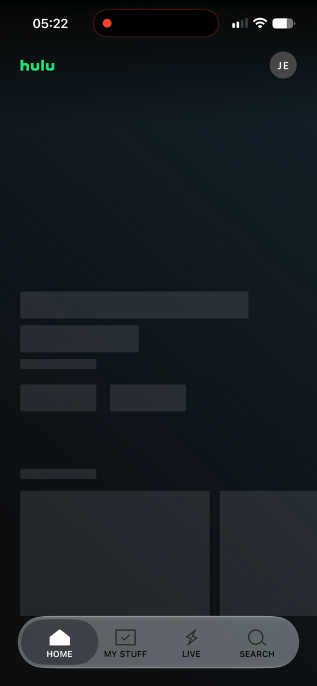

**Why it works:** The skeleton blocks pulse while the page loads, which reassures the user that the layout will appear in a few seconds.

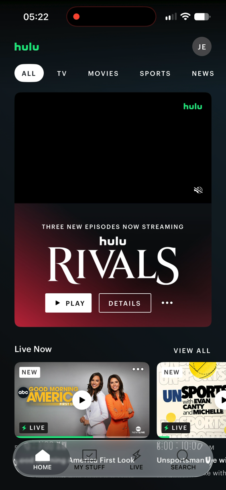

**Why it works:** The Play button is solid white and the Details button is only an outline, so the eye goes straight to Play, which is what users are there for.

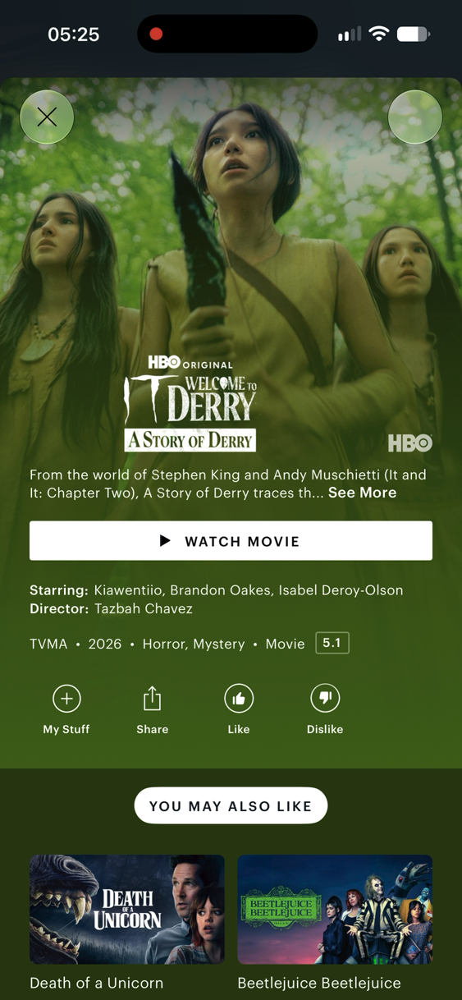

**Why it works:** The page background takes its colour from the film's artwork, so every film's page feels like it belongs to that film without the app needing a brand colour of its own.

**What I'd avoid:** The tab labels are all capitals with wide spacing, which makes them slower to read and leaves less room when the text size is increased.

## Prime Video

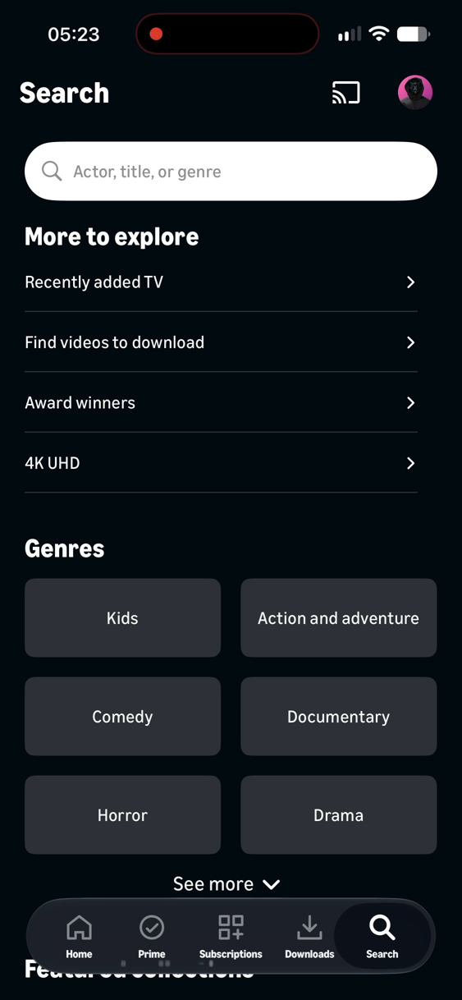

**Why it works:** Search shows genres and browse links before I type anything, so users who don't have a title in mind can still start from a genre.

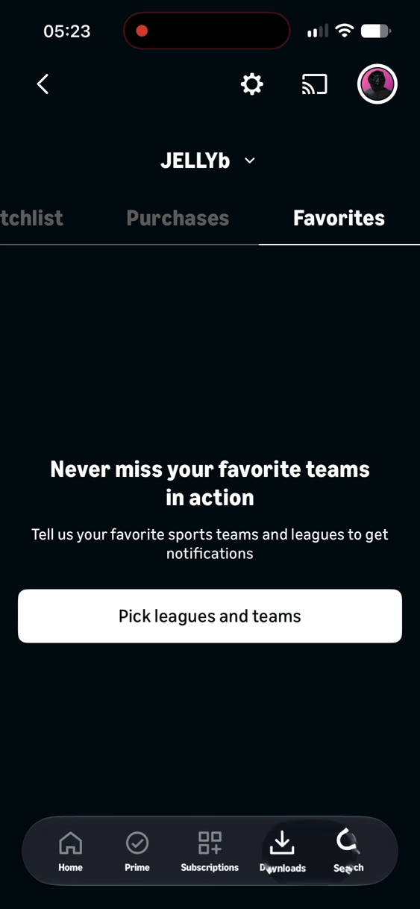

**Why it works:** The empty screen has one headline, one line and one button, so the user knows why it is empty and the one thing to do about it.

**What I'd avoid:** Changing tabs shows a spinner on a blank screen, which might frustrate users on a bad connection, because they can't tell whether the problem is their internet or the app.

## Peacock

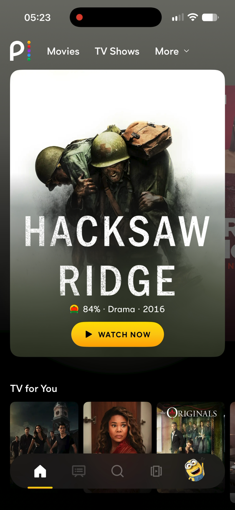

**Why it works:** The hero shows one poster, one line of details and one button, so the user doesn't get overwhelmed.

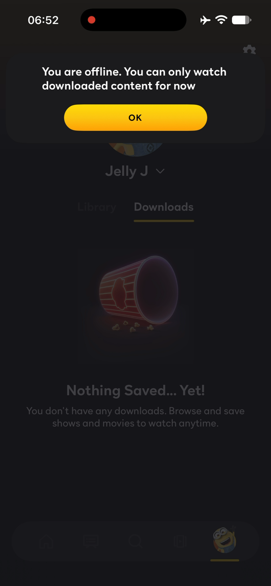

**Why it works:** The app says I'm offline in plain words and still shows the home screen it saved, so I know what is wrong and I'm not left looking at an empty screen.

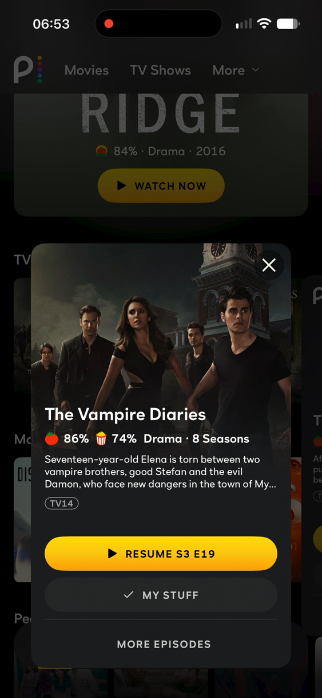

**Why it works:** The three buttons get lighter from top to bottom, so the most likely action is the easiest to see and the others stay out of the way.

**What I'd avoid:** Searching with no internet spins forever, which annoys users because the app never tells them the search can't finish.

## Disney+

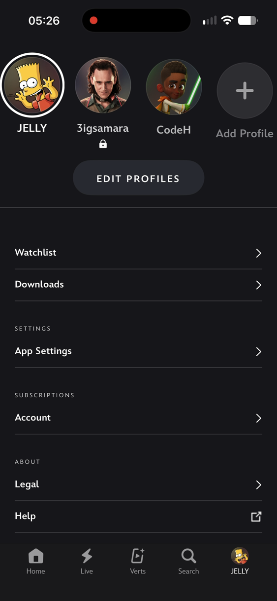

**Why it works:** Settings are grouped under small section labels, so it is easier for users to find the setting they are looking for.

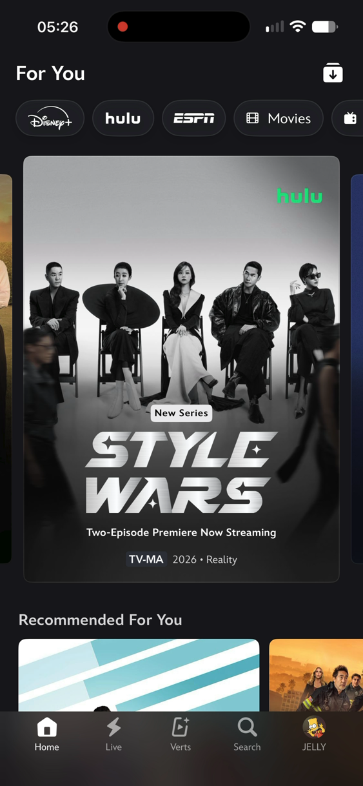

**Why it works:** The edges of the next and previous posters peek in from the sides, so users can tell there is more to swipe to without being told.

**What I'd avoid:** A tooltip covers the content the first time the app opens, which blocks the user's view of what they came to see.

## Apple TV

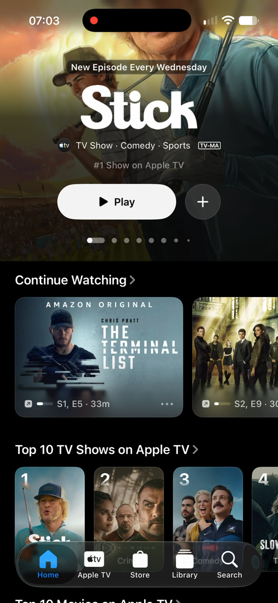

**Why it works:** The poster runs edge to edge, right up under the status bar, so the film is the first thing on screen and the app itself fades into the background.

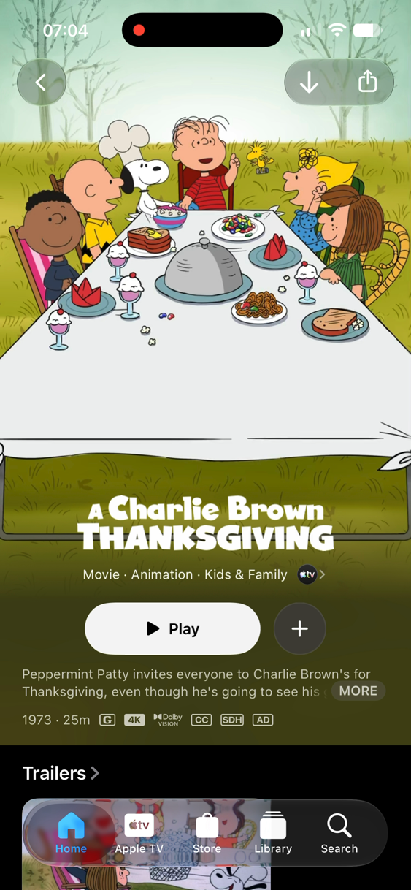

**Why it works:** The description is cut to two lines with a "More" link that opens a sheet, so the page stays short and users who want the full details can still read them before deciding.

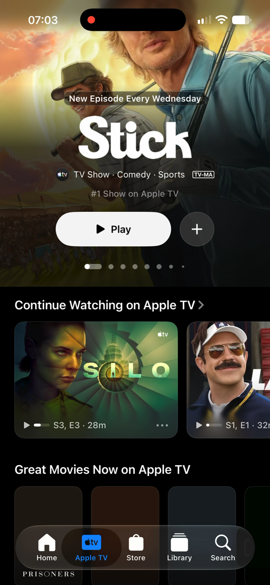

**Why it works:** The nav floats as a pill and content scrolls behind it, so it has a glassy look and the user can see more content coming up underneath.

**What I'd avoid:** The offline error explains the problem but has no retry button, which is like a doctor telling you what is wrong without prescribing anything to cure it.

## AMC Theatres (booking flow only)

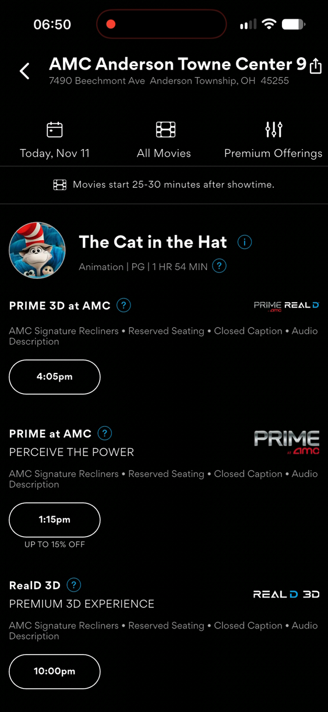

**Why it works:** Showtimes are tappable pills grouped under each screen format, so users choose the kind of screening first and then only see the times that match it.

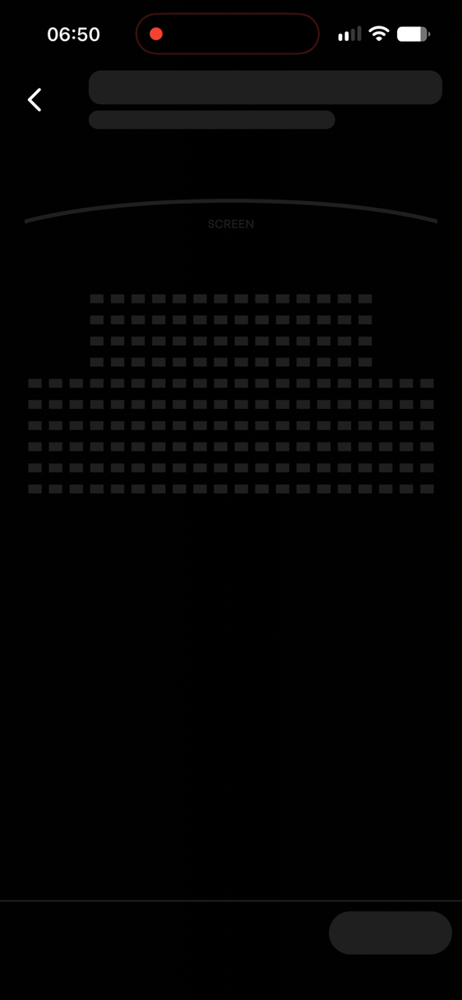

**Why it works:** A skeleton of the room appears before the real seats load, so users already know where the screen and the rows are when the seats arrive.

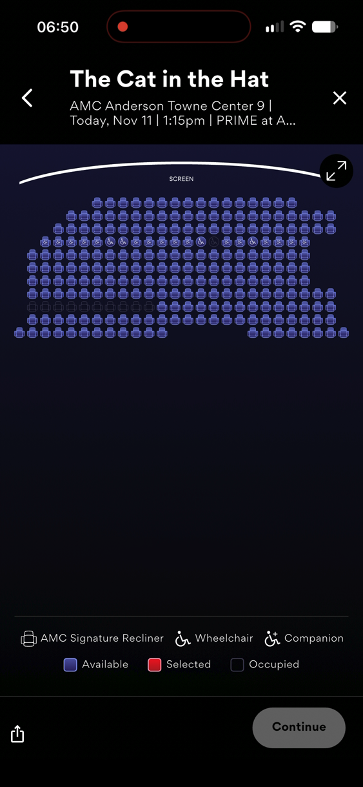

**Why it works:** The whole room fits on one screen before I zoom in, so users can see which parts of the room are free and how close they are to the screen.

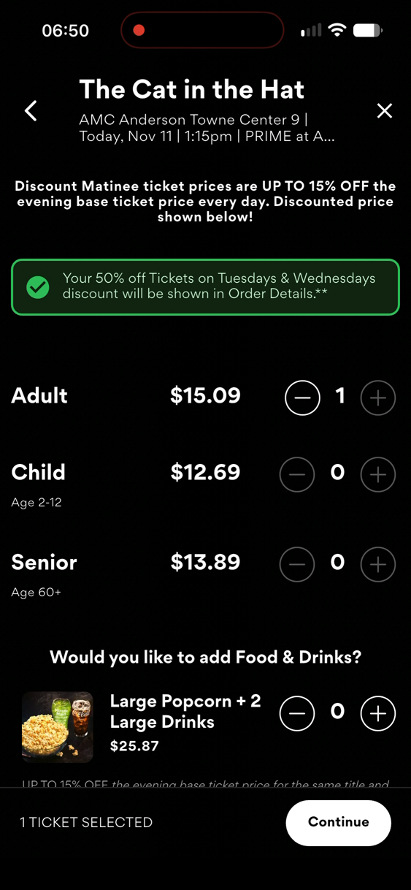

**Why it works:** A footer always shows how many tickets I've picked beside the Continue button, so users never have to scroll to check their selection or to move on.

**What I'd avoid:** Available, selected and taken seats are the same shape and differ only by colour, which makes them hard to tell apart for colour-blind users.

**What I'd avoid:** The error says "Oops an error has occurred" with only an OK button, which tells users nothing about what went wrong or how to fix it.

## What I'm taking into Matinee

1. Matinee will show skeletons that match the final layout, because it shows users their time isn't being wasted.
2. Matinee will have one solid button per screen, because users are there to book a ticket for the film they want to watch.
3. Matinee will let the poster fill the top of Home and Movie detail, because the film is what users came for and the artwork supplies the colour.
4. Matinee will show the whole room before zooming into seats, because users need to know which seats are taken and which are free.
5. Matinee will tell seats apart by shape as well as colour, because it helps users find a seat faster, including users who can't tell the colours apart.
6. Matinee will keep showing saved content when offline, because a ticket has to open at the cinema door even with no signal.
7. Matinee will give every error a reason and a retry button, because knowing what went wrong and how to try again is what solves the problem.
